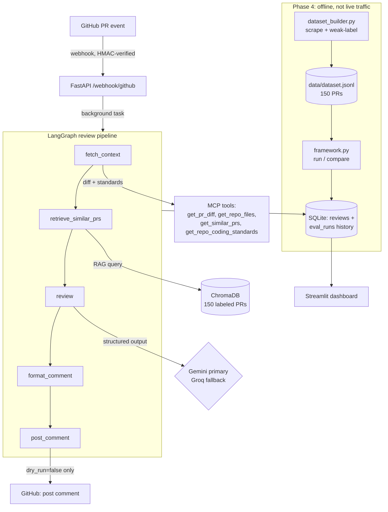

# PRSense

AI-powered GitHub PR review bot. 100% free stack: Gemini/Groq LLMs, LangChain +
LangGraph, MCP tools, ChromaDB RAG, FastAPI, Streamlit. Built around a rigorous
evaluation framework that proves each iteration's improvement with metrics —
not vibes.

> Status: **Phases 1-5 built.** Eval numbers are real but partial (see the
> Phase 4 results table — free-tier LLM quotas are the actual bottleneck, not
> the engineering). Not yet deployed to a live repo — see `DEPLOY.md`.

## The problem

PR review bots are easy to build and easy to make useless: either they
re-paste the whole diff into one giant prompt and call it a day (expensive,
unfocused, no way to tell if it's actually helping), or they ship with zero
way to measure whether their output is any good before — and after — you
change the prompt. This project does neither:

- **Tool-calling, not one giant prompt.** The LLM reaches for the diff, repo
  standards, and similar historical PRs as MCP tools, the same way a human
  reviewer would pull up context instead of reading one wall of text.
- **An actual evaluation harness**, not a demo video. 150 real historical
  PRs across 3 open-source repos, weak-labeled from auditable public
  signals (reverts, regression reports — see `app/evals/labeling.py`),
  scored for precision/recall/F1/false-positive-rate, with an A/B harness
  to test whether a prompt change actually helps before trusting it.
- **100% free**, which turned out to be the real constraint worth
  documenting honestly: Gemini's actual free tier is 20 requests/day on the
  current flash model, Groq's is ~200k tokens/day — found out by hitting
  both live mid-build, not by reading marketing copy. The results table
  below is partial *because of that*, and says so.

## Architecture



MCP tools are backed by one shared implementation
(`app/mcp/tools.py`) — the live graph calls them directly (no subprocess
per review, keeps latency honest for the eval harness), while
`app/mcp/server.py` exposes the exact same tools over stdio for any
external MCP client (Claude Desktop, another agent) to use.

## Stack (all genuinely free)

| Concern | Choice | Free tier |
|---|---|---|
| LLM (primary) | Google Gemini | free, but only 20 req/day on `gemini-3.6-flash` — see limits table below |
| LLM (fallback) | Groq | free, but `openai/gpt-oss-120b`'s real cap is ~200k tokens/day — also found by hitting it live |
| Orchestration | LangChain + LangGraph | OSS |
| Tool protocol | MCP | OSS |
| Vector store | ChromaDB (local) | OSS |
| Relational DB | SQLite (dev) / Supabase (prod) | free |
| Tracing/evals | LangSmith | free tier |
| API | FastAPI | OSS |
| Dashboard | Streamlit | OSS |
| Hosting | Render (or Railway) free tier | free, but disk is ephemeral — see `DEPLOY.md` |

## What's here

```
prsense/
├── app/
│   ├── main.py                 # FastAPI app, /health
│   ├── core/
│   │   ├── config.py           # pydantic-settings, .env driven
│   │   ├── logging.py          # stderr (keeps MCP stdout stream clean)
│   │   └── github_client.py    # PyGithub wrapper: diff, files, metadata, comment
│   ├── webhooks/github.py      # POST /webhook/github, HMAC-SHA256 verified
│   ├── rag/
│   │   ├── embeddings.py       # local ONNX MiniLM (default) | Gemini (opt-in)
│   │   └── retriever.py        # ChromaDB store of historical PRs + labels
│   ├── mcp/
│   │   ├── tools.py            # get_pr_diff / get_repo_files / get_similar_prs /
│   │   │                       #   get_repo_coding_standards  (plain, testable fns)
│   │   └── server.py           # FastMCP server (stdio) wrapping those tools
│   ├── agents/
│   │   ├── mcp_bridge.py       # loads MCP tools as LangChain tools for LangGraph
│   │   ├── schema.py           # Finding / ReviewResult (structured LLM output)
│   │   ├── prompts.py          # review prompts (v1 baseline + v2 precision-focused)
│   │   ├── llm.py              # Gemini primary, Groq fallback, provider override
│   │   └── graph.py            # the 5-node LangGraph review pipeline
│   ├── evals/
│   │   ├── labeling.py         # per-repo revert/regression/security detection (GitHub Search API)
│   │   ├── dataset_builder.py  # scrape + label historical PRs -> data/dataset.jsonl
│   │   ├── metrics.py          # precision/recall/F1/FPR + latency percentiles (pure fns)
│   │   ├── framework.py        # offline eval runner, caching, A/B comparison
│   │   └── regression_suite.py # curates the fixed must-catch/must-not-flag case set
│   └── db/client.py            # SQLite: eval-run history + the live "reviews" feed
├── dashboard/streamlit_app.py  # KPIs, eval trends, latency, recent-reviews feed
├── scripts/
│   ├── phase2_demo.py          # seed / query / mcp  — hands-on, no keys
│   └── phase3_demo.py          # run the full agent on a real PR — needs 1 LLM key
├── data/dataset.jsonl          # the 150-PR labeled dataset (tracked -- see Phase 4)
├── DEPLOY.md                   # Render/Railway free-tier deployment, incl. the disk caveat
├── .github/workflows/ci.yml    # unit tests always; regression suite if a key secret exists
└── tests/                      # 31 tests (webhook, MCP, agent graph, eval metrics/framework/db, dashboard — all mocked)
```

### MCP tools exposed to the LLM

| Tool | Purpose |
|---|---|
| `get_pr_diff(pr_id)` | unified diff + per-file summary (`pr_id` = `owner/repo#123`) |
| `get_repo_files(repo, path, ref?)` | one file's content for extra context |
| `get_similar_prs(diff_text, n_results?)` | RAG over ChromaDB of historical PRs (with bug/revert labels) |
| `get_repo_coding_standards(repo, ref?)` | CONTRIBUTING.md, linters, `.editorconfig`, … |

## Phase 2 — try it (no API keys)

```bash
.venv\Scripts\python scripts\phase2_demo.py seed                       # index demo PRs
.venv\Scripts\python scripts\phase2_demo.py query "auth token is None" # RAG lookup
.venv\Scripts\python scripts\phase2_demo.py mcp                        # call tools via MCP
```

First run downloads the ONNX embedding model once (~79 MB, to `~/.cache/chroma`),
then everything is offline. ChromaDB telemetry is disabled.

## Phase 3 — the review agent

```
fetch_context → retrieve_similar_prs → review → format_comment → post_comment
```

- **fetch_context / retrieve_similar_prs**: call the same functions the MCP
  server exposes (`app/mcp/tools.py`) directly — no subprocess spawned per
  review, which keeps the Phase 4 eval harness fast. The MCP server itself
  still stands as the interface for any *external* MCP client.
- **review**: Gemini primary, Groq automatic fallback on any error (quota,
  timeout, missing key), structured JSON output (`ReviewResult` — summary,
  typed findings with severity/file/line, overall risk).
- **format_comment**: findings → a readable Markdown GitHub comment.
- **post_comment**: gated by `AUTO_POST_COMMENTS` (default `false` — dry run,
  logged only). Flip it to `true` in `.env`, or pass `--post` to the demo
  script, once you trust the output.
- **Tracing**: every node is `@traceable`; set `LANGSMITH_TRACING=true` +
  `LANGSMITH_API_KEY` in `.env` to see each run's node-by-node trace at
  smith.langchain.com (free tier). Off by default — nothing phones home
  until you opt in.

Try it (needs one free key — `GEMINI_API_KEY` from
[aistudio.google.com/apikey](https://aistudio.google.com/apikey)):

```bash
.venv\Scripts\python scripts\phase3_demo.py                          # dry run, real PR
.venv\Scripts\python scripts\phase3_demo.py --pr pallets/flask#6145
.venv\Scripts\python scripts\phase3_demo.py --post                   # actually comments — careful
```

Without any key, `scripts/phase3_demo.py` prints the signup links and exits;
`tests/test_agent_graph.py` covers the graph's logic fully mocked, no key
needed.

## Phase 4 — evaluation framework

Needs `GITHUB_TOKEN` in `.env` (dataset scraping) and at least one LLM key
(eval runs). **This is the part of the project meant to be defensible, not
decorative** — every number below comes from a real run against real merged
PRs, not a hand-picked example.

### 1. Build the labeled dataset

```bash
.venv\Scripts\python -m app.evals.dataset_builder build --per-repo 50   # ~150 PRs total
.venv\Scripts\python -m app.evals.dataset_builder stats
```

Labels (`had_bug`, `had_security_issue`, `clean_merge`, `reverted`) are
derived from auditable public signals, not guessed — see
[`app/evals/labeling.py`](app/evals/labeling.py) docstring for the exact
rules. This is a **high-precision, low-recall** scheme: it will under-count
bugs that were fixed without referencing the original PR number. To measure
how good the auto-labeling actually is:

```bash
.venv\Scripts\python -m app.evals.dataset_builder audit --n 30   # -> data/label_audit.csv
# fill in the human_label column by hand, then:
.venv\Scripts\python -m app.evals.dataset_builder audit-report   # -> measured labeling precision
```

### 2. Index the dataset for RAG, then run an eval

```bash
.venv\Scripts\python -m app.evals.framework index                              # seed ChromaDB
.venv\Scripts\python -m app.evals.framework run --config v1_baseline --sample 50
.venv\Scripts\python -m app.evals.framework history
```

Reports precision / recall / F1 / false-positive-rate (PR-level: does the
agent flag ≥1 bug/security finding on a PR that's actually labeled buggy?)
and latency p50/p95/p99. Every LLM call is cached to disk keyed by
`(config, pr_id, diff)` — re-running the same config again is instant and
free; only a genuinely new (config, PR) pair spends quota.

### 3. A/B compare configs

```bash
.venv\Scripts\python -m app.evals.framework compare --configs v1_baseline v2_precision --sample 50
.venv\Scripts\python -m app.evals.framework compare --configs v1_baseline no_retrieval --sample 50
```

Built-in configs (`app/evals/framework.py::CONFIGS`): `v1_baseline`,
`v2_precision` (a stricter prompt that suppresses nitpicks), `no_retrieval`
(RAG turned off — isolates whether the ChromaDB similar-PR lookup actually
helps), `groq_only`, plus `v2_precision_groq`/`no_retrieval_groq` (same as
above but pinned to Groq — see the quota note below for why). Every run is
stored in SQLite (`data/prsense.db`) with its git commit hash and timestamp,
so `history` shows a clear before/after trail as the project evolves.

#### Results so far (2026-10-23/24, commit `de9d242`+, 150-PR dataset, `n` = effective sample after excluding quota failures)

| config | n | precision | recall | F1 | FPR | p50 latency |
|---|---|---|---|---|---|---|
| **`v1_baseline`** (auto: Gemini→Groq, production default) | **49/50** | **0.45** | **0.63** | **0.53** | **0.15** | 18.3s |
| `v2_precision` (auto) | 14/50 | 0.50 | 0.67 | 0.57 | 0.18 | 11.8s |
| `groq_only` (v1 prompt, Groq forced) | 48/50 | 0.20 | 0.29 | 0.24 | 0.20 | 12.0s |
| `v2_precision_groq` (Groq forced) | 27/50 | 0.25 | 0.50 | 0.33 | 0.26 | 9.0s |
| `no_retrieval_groq` (Groq forced, RAG off) | 14/50 | 0.25 | 0.33 | 0.29 | 0.27 | 2.0s |

**Read this honestly, not optimistically:**
- **`v1_baseline` is the one number here worth actually trusting**: n=49/50
  (only 1 call failed), run with the real production code path
  (`provider="auto"`, Gemini-primary/Groq-fallback). Precision 0.45,
  recall 0.63, F1 0.53 — meaningfully better than every Groq-forced
  variant above, which suggests Gemini is doing real work when it's
  available, not just acting as an occasional tie-breaker.
- The other four rows are genuinely partial (14-48 of 50) for the reasons
  below, and none of them share the same successful subset of the 50-PR
  sample (different calls failed in each run), so **cross-row comparisons
  are directional signal, not a tightly matched A/B** — real differences,
  just not statistically tight ones yet.
- `v2_precision` scoring better than `v1_baseline` on every metric it has
  data for (both as `auto`, and as the Groq-forced pair) is a *consistent*
  signal across two separate comparisons now — encouraging for the
  "suppress nitpicks" hypothesis — but its largest sample is still only
  n=27. Worth a full run once quota allows to see if it holds.
- `no_retrieval_groq` (RAG turned off) is still too thin (n=14) to say
  anything about whether retrieval actually helps. Its much lower p50
  latency (2.0s vs 9-18s elsewhere) is real, though — no RAG lookup, fewer
  tokens, faster response, independent of whether it reviews better.
- **Why these are partial**: Gemini's real free tier is **20 requests/day**
  on `gemini-3.6-flash` (not ~1500/day like older flash models — found out
  by hitting it live), and Groq's `openai/gpt-oss-120b` caps at **~200,000
  tokens/day**. A `review_with_fallback()` circuit breaker (added after
  watching it waste ~30s/call retrying an already-exhausted Gemini) now
  skips straight to Groq once Gemini's daily quota is detected as spent,
  which is what let `v1_baseline` finish in minutes instead of timing out
  repeatedly like earlier attempts.

**Practical free-tier ceiling for this project**: roughly 20 Gemini calls/day
+ ~65-130 Groq calls/day (200k TPD ÷ ~1.5-3k tokens/review) ≈ **100-150 total
LLM-backed reviews per day across both providers, for free.** A full 150-PR
eval of one config alone can eat most of a day's Groq budget. Running
several configs back-to-back (as in `compare`, or one `run` after another)
will usually exhaust it before the last one finishes — every call result is
cached, so re-running the same command on a later day only pays for whatever
didn't succeed yet, which is how this table filled in across multiple days.

### 4. Regression suite (must-always-pass cases)

```bash
.venv\Scripts\python -m app.evals.regression_suite select --n-bugs 6 --n-clean 6
.venv\Scripts\python -m pytest -v -m regression
```

Picks the highest-confidence bug cases (reverted PRs — the strongest signal)
and the highest-confidence clean cases (oldest, smallest merged PRs) into a
fixed `data/regression_cases.json`, then runs the *real* agent against every
one. Runs in CI (`.github/workflows/ci.yml`) against a `GEMINI_API_KEY`
repo secret if one is configured; self-skips otherwise rather than failing.
The everyday `pytest -q` / `pytest -v` run excludes this marker by default
(see `pytest.ini`) so normal development never burns LLM quota.

## Phase 5 — dashboard

```bash
.venv\Scripts\python -m streamlit run dashboard\streamlit_app.py
```

Opens at http://localhost:8501. Reads `data/prsense.db` directly — four KPI
tiles (PRs reviewed, findings surfaced, comments posted), a latest-score
table per eval config, precision/recall/F1/FPR trend lines, p50/p95/p99
latency bars, and a recent-reviews feed. Every section shows an honest empty
state (not a fabricated chart) when there's nothing to show yet — e.g. the
reviews feed is empty until the webhook or `scripts/phase3_demo.py` actually
runs the agent at least once. Verified with `streamlit.testing.v1.AppTest`
(`tests/test_dashboard.py`) against both an empty and a populated db, so this
is covered by the normal `pytest -q` run too.

Deployment (Render/Railway free tier, including the one real caveat — ephemeral
disk on both platforms' free services): see **`DEPLOY.md`**.

## Setup

```bash
cd prsense
python -m venv .venv
.venv\Scripts\activate           # Windows;  source .venv/bin/activate on *nix
pip install -r requirements.txt
copy .env.example .env           # then fill in values
```

Python 3.11+ required (developed on 3.14).

## Run

```bash
.venv\Scripts\python -m uvicorn app.main:app --reload --port 8000
```

- `GET  /health` → config sanity check
- `POST /webhook/github` → GitHub PR event receiver

## Test

```bash
.venv\Scripts\python -m pytest -q
```

## Local webhook testing

1. Start the server on :8000.
2. Expose it: `ngrok http 8000` (free) → copy the https URL.
3. On a test repo you own: Settings → Webhooks → Add webhook
   - Payload URL: `https://<ngrok>.ngrok-free.app/webhook/github`
   - Content type: `application/json`
   - Secret: same value as `GITHUB_WEBHOOK_SECRET` in `.env`
   - Events: "Pull requests" only
4. Open/reopen a PR, or use "Recent Deliveries → Redeliver" to replay.

Without ngrok you can still replay a captured payload with `curl` (see tests).

## Free-tier limits to watch

| Service | Limit | Notes |
|---|---|---|
| GitHub API | 5000 req/hr authenticated | `github_client.rate_limit_remaining()` |
| ngrok free | 1 online tunnel, random URL each restart | fine for dev |
| Gemini free (`gemini-3.6-flash`) | **20 req/DAY** — verified by hitting it live during Phase 4 evals | Far too small for bulk eval runs; see below |
| Groq free | ~14.4k req/day, model-dependent RPM | The real workhorse for eval volume — Gemini's 20/day covers little more than spot-checks |

## Roadmap

- [x] Phase 1 — Foundation (FastAPI, webhook, GitHub client)
- [x] Phase 2 — MCP server + 4 tools, ChromaDB RAG, LangChain/LangGraph bridge
- [x] Phase 3 — LangGraph review state machine + LangSmith tracing
- [x] Phase 4 — Evaluation framework built and run: 150-PR dataset scraped (flask/requests/fastapi). `v1_baseline` (the real production config) run to near-completion (n=49/50): P=0.45 R=0.63 F1=0.53. **Ongoing**: `v2_precision`, `no_retrieval` still partial (n=14) — filling in as daily free-tier quota allows; every run is cached, so this costs nothing extra, just time.
- [x] Phase 5 — Streamlit dashboard (`dashboard/streamlit_app.py`) + deployment docs (`DEPLOY.md`). **Not yet actually deployed** — see `DEPLOY.md` for why that's a deliberate "when you're ready" step, not a blocker.

### Eval results (filled in after the first real run)

| Config | n | Precision | Recall | F1 | FPR | p50 latency |
|---|---|---|---|---|---|---|
| _pending dataset build_ | – | – | – | – | – | – |
